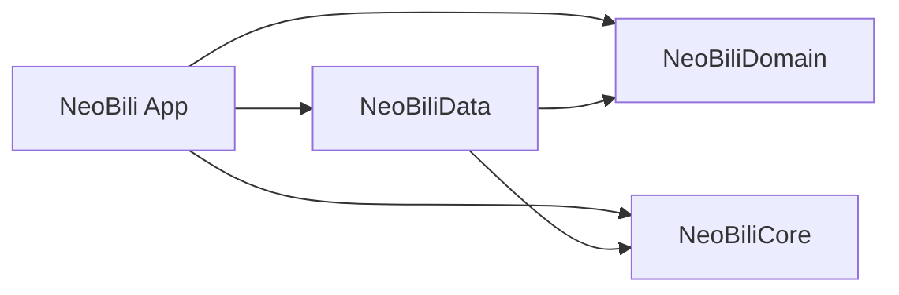

# 架构

NeoBili 是使用 SwiftUI 和 MPVKit 的 iOS 客户端，没有单独部署的服务器。“前后端解耦”在本项目中指：页面和业务状态依赖服务契约，网络、签名及存储实现通过适配器提供。值与服务契约由静态框架 `NeoBiliDomain` 编译，通用缓存、共享请求池与日期格式化由 `NeoBiliCore` 编译；两个模块均没有项目内依赖。网络、身份、签名、上报和媒体缓存由 `NeoBiliData` 编译，依赖 Domain 与 Core。其余层由 `NeoBili` App target 编译；App 组装 Data 适配器，Application / Features 只使用领域契约，其目录边界继续由检查脚本维护。

构建、测试和设备使用统一见[开发与测试](DEVELOPMENT.md)。

## 目录与依赖方向

| 目录 | 负责什么 | 不应放入什么 |
| --- | --- | --- |
| `App` | 启动、根路由、生产依赖组装 `ApplicationServices+Live` | 接口字段和响应解析 |
| `Features` | SwiftUI 页面、交互和展示组件 | HTTP 请求、签名、凭据读取 |
| `Application` | 页面状态、加载任务、分页、缓存及播放协调 | URLSession、接口地址和传输协议 |
| `Domain/Services` | 按业务划分的可注入操作、账号快照、实时通道协议 | 生产客户端单例和网络实现 |
| `Domain/Models` | 共享值、解码模型、筛选规则和设置值 | 页面类型、播放器实例、网络访问 |
| `Data/Services` | 将服务契约连接到生产实现的适配器 | SwiftUI 页面状态 |
| `Data/Networking` | 端点、传输、身份、签名、响应解析及上报 | View / ViewModel 依赖 |
| `Data/Media` | 图片传输与缓存、弹幕下载 | 页面导航 |
| `Platform` | mpv、系统媒体控制等平台适配 | 业务页面 |
| `Core/Caching`、`Core/Formatting` | 不依赖业务的请求合并、内存缓存与日期格式化（NeoBiliCore） | 页面、账号、生产默认实例 |
| `Core/UI`、`Core/Extensions` | 共享组件、主题、格式化和交互工具 | 业务接口调用 |
| `App/Diagnostics`、`Core/Diagnostics` | 显式启用的业务诊断/回放与通用滚动测量 | 默认后台探测 |

通常的请求路径是：`View → Application model → Domain service → Data adapter → APIClient`。简单的一次性操作可以由 View 使用环境中的服务完成；分页、重试和长任务由状态模型持有。

编译模块依赖如下；Domain 与 Core 没有项目内依赖：

App target 包含 App、Application、Features、Platform 和共享 UI。Application / Features 禁止导入 Data；生产组装位于 App，平台媒体适配可使用 Data 的窄接口。内部端点、编码器细节和队列模型不作为公共 API，测试通过 `@testable import NeoBiliData` 验证。

## 服务如何注入

`ApplicationServices` 是按业务分组的值类型。`App/ApplicationServices+Live.swift` 组装生产实现；页面通过 `EnvironmentValues.applicationServices` 取得依赖。模型通过初始化参数接收服务或更小的 loader / writer 闭包。已有的默认初始化方式仍使用生产组装，方便普通页面创建。网络客户端、传输、WBI 签名器与身份的生产便利初始化器位于 `App/NetworkingDefaults.swift`，转发到 Data 的显式依赖初始化器。生产网络会话由 App 持有；Data 的会话工厂保留编译期 Regression 隔离，端点和缓存显式接收 session 或传输闭包。

`ApplicationStores` 统一持有点赞差量、关注已读和搜索历史，生产图由 App 组装。关注父子模型共享注入的点赞状态；搜索页面显示与模型写入同一历史实例。

测试为当前模型创建独立依赖，不替换全局单例。只实现该测试需要的操作；未配置操作抛出明确错误，不能假装成功。测试创建的服务应随模型传入其子模型，避免子模型意外使用生产默认值。`AccountSessionClient` 管理登录存储边界；`LiveDanmakuStreaming` 管理实时通道，展示模型接收连接状态、热度及消息事件。

服务契约与线上协议名有部分对应，便于核对研究证据；调用方不接触 `APIClient`、`DeviceIdentity` 或端点 URL。`Live*Service` 负责将领域操作映射到现有协议实现；工厂与端点接收显式客户端、身份及上报依赖，生产默认入口仅在 App 组装层提供。测试若要验证传输行为，应直接注入端点的客户端；服务单元测试则替换操作闭包。

## 状态与任务所有权

`NowPlayingStore` 从打开到关闭持有当前媒体、详情模型和返回历史。`PlayerViewModel` 协调播放、画质、备用源与本地续播；`PlaybackReportingCoordinator` 管理观看累计、心跳和播放行为边界，平台会话负责内核。账号切换或媒体切换后，旧标识的回调不能修改新状态。

页面模型持有自己的加载任务。共享缓存持有共享下载任务，单张卡片退出只取消自己的等待。直播实时连接拥有认证、心跳和重连任务，`stop()` 统一终止；展示模型拥有列表合并和 SC 历史任务。

详细规则按问题阅读：

- [账号、身份与请求](architecture/accounts.md)
- [播放与观看记录](architecture/playback.md)
- [列表、图片与取消](architecture/lists-images.md)
- [设置分类与持久化](SETTINGS.md)

## 如何扩展

1. 在 `Domain` 定义调用方需要的数据和操作，避免引用页面嵌套类型。
2. 在 `Data` 实现接口适配，复用现有身份校验、错误处理和取消机制。
3. 在 `App` 组装生产依赖，在 `Application` 管理操作状态，在 `Features` 呈现结果。
4. 测试业务状态时注入受控服务；测试端点时使用受控传输。不要为了运行单元测试读写真实账号。
5. 移动源码后同步离线测试的输入路径，并运行 `python3 scripts/check-architecture.py` 和开发指南中的相关检查。

`project.yml` 是工程配置来源；各层分别采用 synchronized folder。Domain 文件只属于 `NeoBiliDomain`，Core/Caching 与 Core/Formatting 属于 `NeoBiliCore`，Data 属于 `NeoBiliData`，其余层属于 App；同一层新增或移动 Swift 文件无需手工登记。跨模块移动需同步配置并重新生成工程。测试显式 `@testable import NeoBiliDomain` / `NeoBiliCore` / `NeoBiliData`；离线 harness 继续直接编译选定源码，条件导入保留这一入口。

播放器事件、画质与手势设置值属于 Domain；mpv 加载和渲染宿主、窗口方向属于 Platform。观看上报、列表删除/入场状态以及设置持久化属于 Application。Domain 不持有 UserDefaults；设备偏好的读取适配位于 Data，纯 URL 归一化位于 Domain。

空间页资料头部和关注动态内容使用独立展示组件；滚动协调、导航和刷新任务仍由父页面持有。全部关注分页状态由 Application 的 `FollowingAllUpsModel` 管理。首页图片预取消费者由 `HomeFeedImagePrefetcher` 在索引路径与显示中的 cell 之间转交，并沿用快照切换和离屏取消入口。

显式启用的性能演示和搜索诊断属于 App 诊断组装。首页模型始终使用传入的 loader，App 根据演示启动参数选择生产默认 loader；诊断模式不会覆盖调用方注入的数据源。窗口方向锁仍是 AppDelegate 与窗口适配共用的进程级系统状态，由 App 创建。

账号凭据变化的通知名属于 Domain 的 `AccountSessionEvents`；Data 发布状态变化，Application 订阅同一通知契约。
